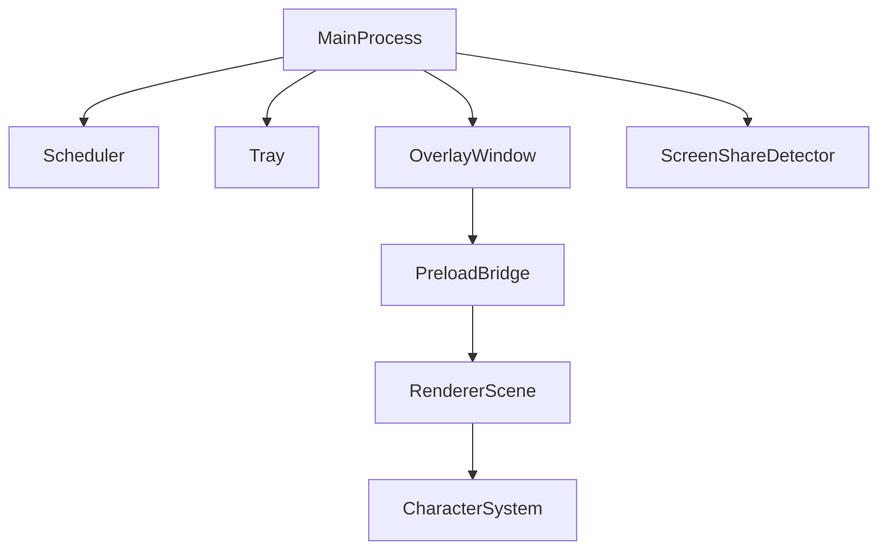
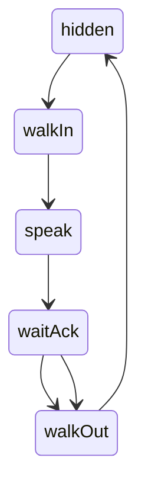
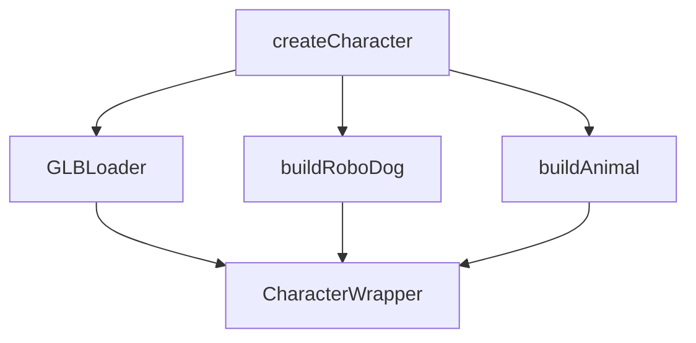

# System Patterns — Desk Buddy

## Overall Architecture



## State Machine (Renderer)



- `hidden` → triggered by `reminder:show` IPC from main
- `walkIn` → character walks to `stopX` (~30% screen width)
- `speak` → plays talk animation, shows speech bubble for `speakSeconds`
- `waitAck` → plays idle animation, waits for user click or `autoSnoozeSeconds`
- `walkOut` → character exits right; cat (if active) follows

## IPC Channels
| Channel | Direction | Purpose |
|---|---|---|
| `renderer:ready` | renderer → main | Renderer is initialized, start pumping queue |
| `reminder:show` | main → renderer | Show a reminder object `{id, text}` |
| `reminder:action` | renderer → main | `{id, action: 'done'|'snooze'}` |
| `character:set` | main → renderer | Switch active character by name |
| `overlay:ignore-mouse` | renderer → main | Enable/disable click-through |

## Character Pattern



Each character implementation exposes:
```js
{ object: THREE.Group, play(name), poke(), update(dt) }
```
The `Character` wrapper adds: `.x` (position), `.face(dir)`, YAW rotation, smooth facing transition.

## Procedural Character Geometry (RoboDog)
- All meshes use `MeshPhongMaterial` (shininess + specular) for cartoon-metallic look
- Shape language: **spheres and cylinders only** — no flat boxes
- Hierarchy: `root → rig → body → [head, neck, legs×4, tail, shoulder bulges]`
- Head faces along body's `+Z` axis; `YAW ≈ π/2` makes `+Z` point at camera
- Animation driven by `update(dt)` with sinusoidal time-based curves — no keyframes

## Scheduler Pattern
- `Scheduler` class reads `reminders.json` on every `due()` call (file watched implicitly by re-read)
- Returns items due since last check; main process enqueues them
- Snooze state and last-fired times persisted in `state.json` alongside character preference
- Missed `at` reminders older than 2 hours are skipped

## Screen-Share Auto-Pause
- Polled every 6 seconds from main process via `child_process.exec`
- Windows: `tasklist` for `CptHost.exe`/OBS + PowerShell registry for mic-in-use
- macOS: `lsof` on CoreAudio + `pgrep CptHost` fallback
- Sets `paused = true` only when mic is actively held open by a known meeting app
- Tray menu reflects auto-pause state; manual override clears the auto-pause flag

## Key Design Decisions
| Decision | Rationale |
|---|---|
| OrthographicCamera in pixel units | Characters positioned in CSS pixels, no perspective distortion |
| Procedural geometry (no GLB required) | Zero external assets needed; GLB swap-in when ready |
| `MeshPhongMaterial` for RoboDog | Metallic sheen without full PBR cost |
| Single tray as only UI | Minimal surface area; no main window to manage |
| `node:test` for scheduler | Zero extra dependencies for unit tests |
| ESM throughout | Future-proof; Electron 44 supports it natively |
